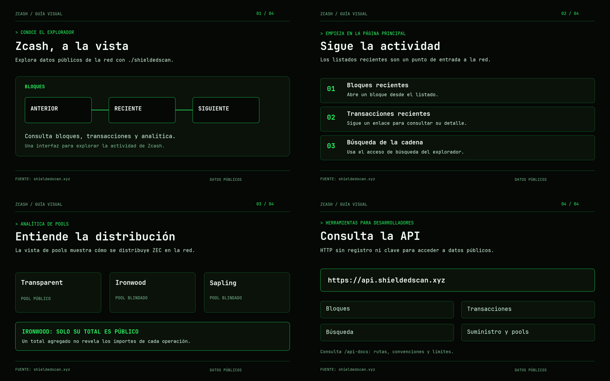

# ./shieldedscan en español

Cuatro imágenes educativas sobre el explorador de Zcash: actividad de la cadena, pools y API pública.

## Entregables

Cada imagen está disponible en PNG de 1600 × 1000 y SVG editable. Los archivos SVG conservan el texto y la geometría; las fuentes JetBrains Mono están incluidas con su licencia OFL.

| Tema | PNG | SVG editable |
| --- | --- | --- |
| El explorador | [PNG](shieldedscan-spanish/01-explorador.png) | [SVG](shieldedscan-spanish/01-explorador.svg) |
| Actividad de la cadena | [PNG](shieldedscan-spanish/02-actividad.png) | [SVG](shieldedscan-spanish/02-actividad.svg) |
| Pools | [PNG](shieldedscan-spanish/03-pools.png) | [SVG](shieldedscan-spanish/03-pools.svg) |
| API pública | [PNG](shieldedscan-spanish/04-api.png) | [SVG](shieldedscan-spanish/04-api.svg) |

## Fuentes

Contenido comprobado el 10 de noviembre de 2026 en [el explorador](https://shieldedscan.xyz/), [la vista de pools](https://shieldedscan.xyz/shielded), [la documentación de la API](https://shieldedscan.xyz/api-docs) y [la guía de marca](https://shieldedscan.xyz/brand).

Tipografía: [JetBrains Mono](https://github.com/JetBrains/JetBrainsMono). Licencia incluida en `fonts/OFL.txt`.

## Regenerar

Con Python y Pillow instalados, ejecuta `python3 render_shieldedscan.py`. El script genera los PNG, SVG y la hoja de contacto en `shieldedscan-spanish/`.
